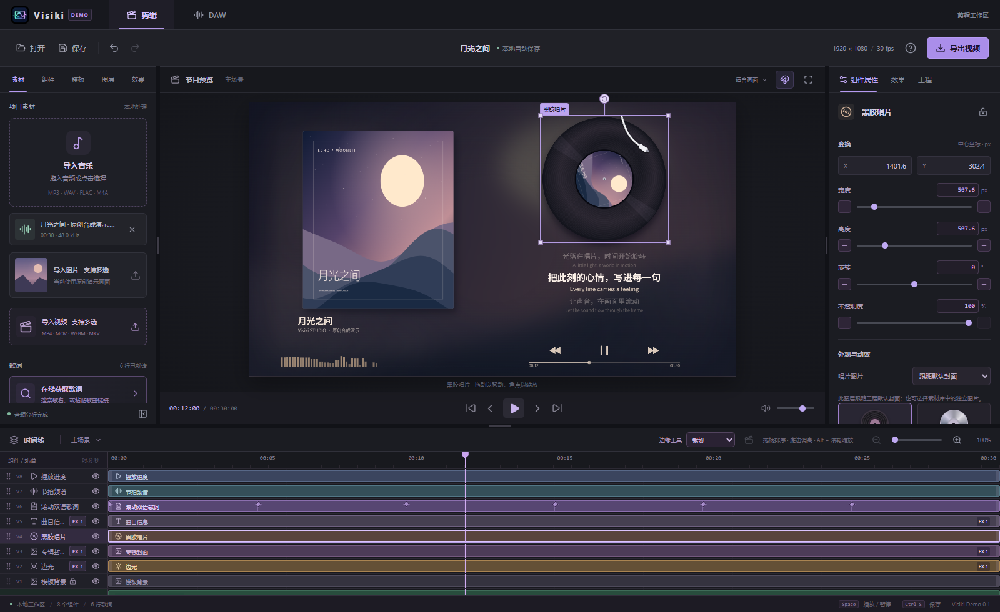
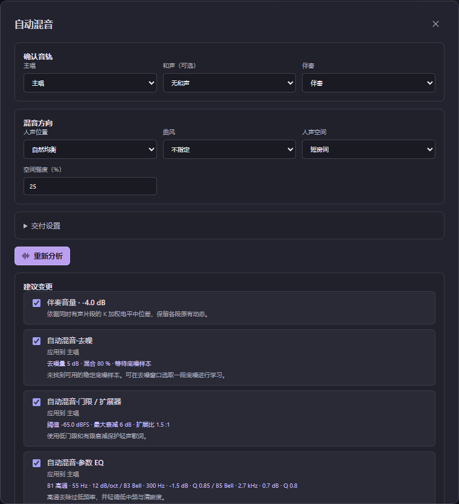

# Visiki

Visiki 是一款 Windows 音乐视频编辑器，也能做多轨混音。你可以在「剪辑」里用音乐、图片、视频和歌词做一条 MV，也可以先到「DAW」把主唱和伴奏混好，再把成品音频送去剪辑。

## 下载和启动

1. [下载 Windows x64 免安装预览版](https://github.com/Sumizu/Visiki/releases/download/v0.1.0-preview.15/Visiki-0.1.0-preview.15-win-x64.zip)。
2. 把整个 ZIP 解压到一个可写的文件夹，双击 `启动Visiki.cmd`。
3. 在欢迎页选「剪辑」或「DAW」。之后可以用窗口顶部的标签切换。

包里已经带了运行和导出所需的组件。处理本地素材可以离线，在线搜索网易云歌词时需要联网。

## 剪辑工作区



### 导入素材并安排时间线

- 导入一首歌和多张图片或视频。背景和封面卡片可以用不同的图片，背景也可以直接用视频。
- 把组件摆在预览画面上，拖动调整位置和大小，再用时间线决定它们什么时候出现。轨道可以改顺序、改高度，也能单独隐藏。
- 视频片段可以分割、裁切、调速和倒放。宽高可以独立调整，也可用色键去掉绿幕或其他选定颜色。图片可以裁成圆形、圆角矩形等形状。

### 排歌词和文字

- 导入 LRC、SRT 歌词，也可以用歌名或网易云歌曲链接搜索。歌词跟随配乐时间，早了或晚了可以整体调整偏移。
- 歌词可单行切换、双语显示或多行滚动。原文和译文可分别选字体，当前句和其他句可用不同的字号、颜色和透明度。
- 歌名和文本框都能独立编辑，也可以加发光。字体可以从包内选择或从本机导入。歌词还支持描边、阴影，以及文字平面的朝向和透视。

### 加入唱片、频谱和画面效果

- 用旋转唱片、播放器装饰和随音乐变化的频谱搭配歌词。频谱有柱状、波浪和心电单曲线等样式。
- 用粒子、光泄漏、薄雾和光束改变画面气氛，也可以给轨道套用调色、胶片质感、故障、音乐联动和淡入淡出效果。配乐本身也可以做音量淡入淡出。
- 可以从模板开始，再移动组件或换掉素材。保存工程后能继续编辑，完成时可选分辨率、帧率和时间范围导出 MP4。

## DAW 工作区

DAW 用于整理和混合多条音轨。把分别录好的主唱、伴奏或和声导入后，可以拖动片段、裁掉空白、分割片段、做淡入淡出，也能调各轨的音量、左右位置、静音和独奏。时间线可用秒或小节显示，支持吸附和节奏分析。

### 自动混音

**有主唱和伴奏就能开始，和声可以留空。**



1. 点击顶部的「自动混音」，选择有音频且未静音的主唱和伴奏轨。需要处理和声时，再选一条和声轨。
2. 按需要选择人声的位置、曲风和空间感。分析后，Visiki 会列出建议，例如调整两轨音量，让主唱更清楚，或给音轨加上均衡、压缩、去齿音和混响。
3. 用同一段音频试听「原工程」「仅平衡」和「平衡＋效果链」，每段最长 20 秒。开启响度匹配后，更容易听出清晰度和音色的区别。建议可以逐项选择，改选后重新计算即可试听。
4. 选「仅应用平衡」或「应用所选建议」。应用后还可以继续调整推子和各项效果，也可以一次撤销。

应用方案时，原有的轨道效果和主输出效果会被关闭，原来的设置会保留。片段上的效果继续生效。

### VST3 效果插件

**可以在 Visiki 里使用本机已安装的兼容 VST3 效果器。**

- 在效果库切换到「VST3」并扫描，然后把找到的插件挂到音轨或主输出。适用范围是兼容的 Windows x64 立体声音频效果器。
- 插件有可用的图形界面时，点击效果链中的名称即可打开它自带的窗口。Visiki 也提供通用的参数面板。
- 插件可以参与播放和 WAV 导出。Agent 也可以通过 MCP 查询插件公开的参数并修改它们。

### 内置效果和导出

使用内置效果就可以做常见处理，例如用 EQ 修整音色、用压缩控制音量起伏、用去噪和去齿音清理人声，或加混响、延迟和合唱。内置效果可以按需挂到一段片段、整条音轨或主输出。

混音完成后，可以导出立体声 WAV，也可以把这份混音直接导入剪辑工作区，接着配画面和歌词。

## MCP 和 Skill

安装包里已经带了 **MCP 服务和两套 Skill**。MCP 让 Agent 能操作正在运行的 Visiki，例如导入素材、编辑工程、运行自动混音、试听和导出。Skill 是给 Agent 的操作指南，`visiki-music-video` 用于剪辑，`visiki-daw` 用于音轨编辑和混音。

### 交给 Agent 安装

把下载链接发给支持本地 MCP 和 Skill 的 Agent，或者告诉它 Visiki 已经解压到哪里。可以直接发这段话。

```text
请帮我安装并接入 Visiki。请用我提供的链接下载 Windows x64 免安装包，完整解压到我指定的文件夹。如果我已经解压，请直接使用那个目录。

请按包内的 MCP接入说明.txt 启动 Visiki、生成配置，并把 visiki MCP 和 skills 目录中的两套 Skill 加到当前客户端。保留我已有的配置，最后检查 Visiki 能否连接。遇到需要我选择目录或确认权限的步骤时，请告诉我。
```

### 手动接入

先启动 Visiki，再运行包内的 `生成MCP配置.cmd`。把生成的 `MCP配置.json` 里的 `visiki` 服务加入客户端，并将 `skills` 下的两个完整文件夹放进客户端的 Skill 目录。重新加载客户端后，先打开要用的工作区。具体设置见包内的 `MCP接入说明.txt`。

接好后保持 Visiki 运行，就可以请 Agent 做具体任务，例如「用这两条音轨自动混音，先给我试听，再应用」。

## 技术简述

桌面界面使用 Electron 和 React。FFmpeg 负责视频导出，多轨混音和音频效果由 C++ 音频引擎处理。

## 致谢

感谢 [163MusicLyrics](https://github.com/jitwxs/163MusicLyrics)、[LRC Scroller](https://github.com/qpbl173/lrc-scroller) 和 [Vizzy](https://vizzy.io/creations) 提供歌词与音乐可视化的参考，也感谢 [FFmpeg](https://ffmpeg.org/)、[Electron](https://www.electronjs.org/) 和 [miniaudio](https://miniaud.io/) 等开源项目。
